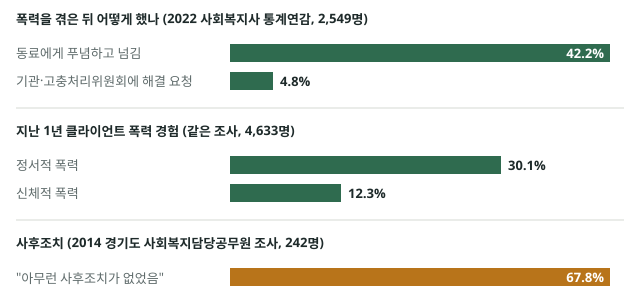
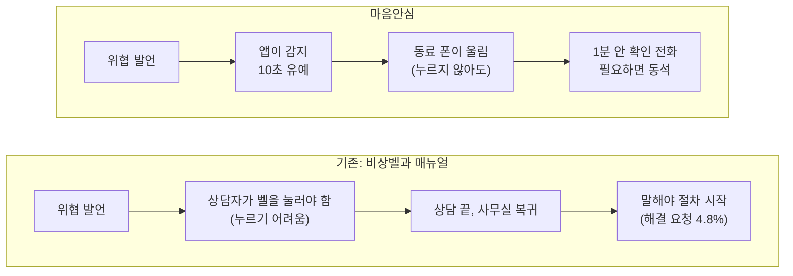
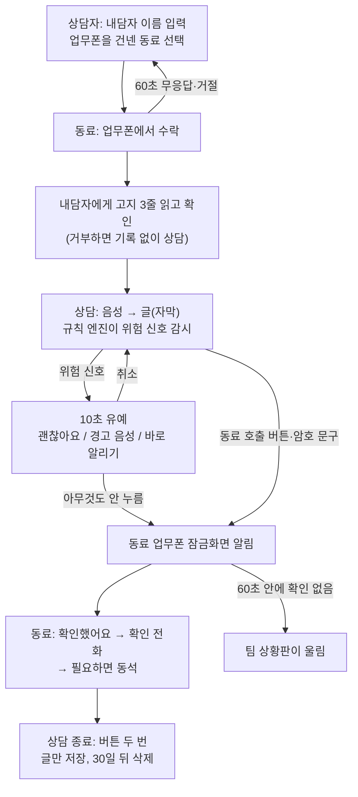
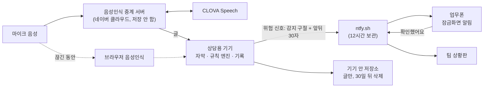
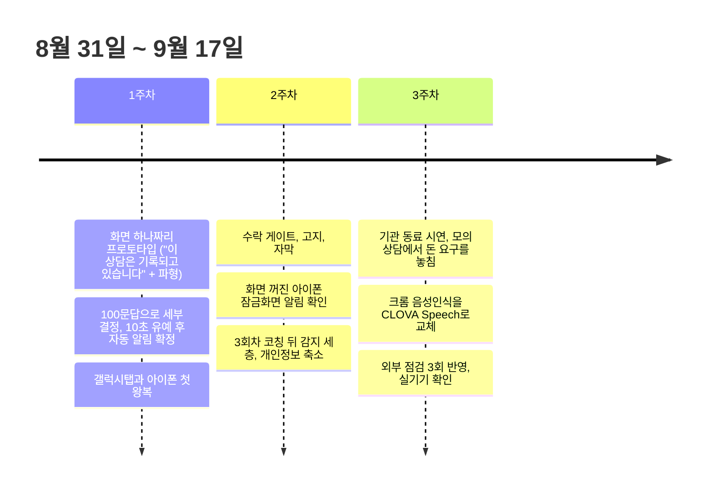

# **사회복지사의 안전한 대면 상담을 위한 동료 연결, 자동 알림 프로그램 "마음안심"**

*1:1 대면 상담 상황에서 사무실 동료 한 사람과 연결하고, 위협 상황이 잡히면 상담자가 버튼을 누르지 않아도 그 동료의 폰이 울리도록 설계했으며, 상담은 음성 없이 글로만 남기는 안전 상담 웹앱입니다.*

> 목표는 상담 전 동료 연결이 기관 매뉴얼의 당연한 절차가 되는 것입니다. 이 앱은 상담 중 개입절차를 만들고, 사후에 실행되는 기관 안전매뉴얼이 최대한 빠른 시간에 실행되도록 돕는 도구입니다. 

이 문서는 2026-09-17 v0.10.19 기준입니다. 숫자·연구·법령·외부 서비스 정책은 원문 또는 초록·공식 문서와 대조했고, 출처와 확인한 범위는 4.2에 적었습니다. 기관마다 정해야 하는 규칙은 "도입 시 기관이 정합니다"로 적었습니다.

---

## **1. 팀 기본 정보**

### **1.1 기관 정보**

**함박종합사회복지관**

함박종합사회복지관은 다양성존중, 서로돌봄, 실천공동체 라는 핵심가치를 토대로 주민 스스로 다양성을 존중하는 협동공동체를 만들기 위해 운영하는 사회복지전문기관입니다. 함박종합사회복지관은 사회복지관의 3대기능인 서비스제공, 지역조직, 사례관리를 기본 바탕으로, 고려인 및 외국인이 밀집해있는 연수1동 함박마을의 특성을 활용하여, 외국인정착지원 및 특화사업을 수행하고 있습니다.

상담 중 폭언, 욕설, 성희롱, 현금 요구 등 부담스러운 요구 상황이 발생하면 즉시 알릴 수 있는 무엇인가 필요 하다는 현장 경험에서 출발했습니다. 또한 이미 상담실 내 비상벨이 있지만 1:1 대면 상담 중 위기 순간에 누르기 어렵다는 경험을 합쳐 위험 상황에 즉시 개입할 수 있는 자동안전 시스템을 만들었습니다.

### **1.2 팀 구성원 정보**

| 구분 | **이름** | **소속·직책** | **AI 챌린지 해에서의 담당 역할** |
| --- | --- | --- | --- |
| 팀장(1인 팀) | 노현래 | 함박종합사회복지관 과장/사회복지사 | 문제 정의와 현장 요구, 설계 결정, 실기기·모의 상담 시험, 기관 동료 의견 수집, 문서 검토와 채택 결정 |
| 팀원 | 없음(1인 팀) | | |

> 코드·문서 작성에 AI 도구(Claude Code, ChatGPT)를 썼습니다. 무엇을 사람이 하고 무엇을 AI가 했는지는 4.1에 구분해 적었습니다. 이 문서에서 "현장 경험"은 담당자가 사회복지사로 일하며 직접 겪은 것이고, 동일기관 혹은 타 기관의 사회복지사의 경험을 바탕으로 작성했습니다.

---

## **2. AI 솔루션**

### **2.1 문제 정의**

> 2.1부터는 요약입니다. 조사 숫자의 출처와 쪽수, 항목별 자세한 내용은 [상세 문서](docs/detail.md)에 같은 번호로 있습니다.

#### 현장의 사실

- 1:1 상담 중에 비상벨이 있어도 내담자와 마주 앉은 위기 순간에 그 비상벨을 누르기 어렵습니다. 상대방을 자극할 수도 있고 그 상황 판단에 대한 자신감도 부족합니다. 기관 동료도 "관내 상담실에도 비상 안심벨이 있지만 사실 상담 중에 그 버튼을 누르기에도 위험한 순간이 있을 수 있다"는 의견을 냈습니다.
- 2022 사회복지사 통계연감: 응답한 사회복지사 4,633명 중 **12.3%가 클라이언트에게 신체적 폭력**을, 30.1%가 정서적 폭력을 경험했습니다. 폭력을 겪은 사람 중 **기관에 해결을 요청한 사람은 4.8%**였고, 동료에게 푸념하고 넘긴 사람이 42.2%로 가장 많았습니다.
- 2014년 경기도 사회복지담당공무원 조사: 응답자 242명 중 60.3%가 지난 1년간 민원인의 신체적 폭력을 겪었고, 폭력 뒤 **"아무런 사후조치가 없었음"이 67.8%**였습니다.
- 1:1 상담 중에 일어난 폭력의 비율을 보여주는 국내외 자료는 찾지 못했습니다.

#### 주요 이용자

- **상담자(사회복지사)**: 2022년 서울시 조사에서 폭력을 겪은 종사자의 32.5%는 기관에 보고하지 않았고, 이유 1위는 '별다른 대응방법이 없을 것 같아서'(38.8%)였습니다.
- **업무폰을 받은 동료**: 상담실 밖에서 대응을 맡는 사람. 알림이 없으면 상담실 안의 상황을 알 수 없습니다.
- **내담자**: 기록과 안전장치가 감시로 느껴지지 않아야 하는 사람.

#### 기존 방식과 한계

| 기존 방식 | 한계 |
| --- | --- |
| 규정·매뉴얼·비상연락망 | 현장 경험으로는, 상담을 시작할 때 누가 대응할지 정해 두는 절차가 없어 매뉴얼이 그 위험순간에 쓰이지 않고 사건이 발생한 이후 사무실에 복귀해야 절차가 시작됩니다. 또한 그 절차는 사회복지사가 위험상황을 겪었다는 이야기를 해야 시작됩니다. |
| 비상벨·호출 버튼 | 상담자가 직접 눌러야 작동합니다. 내담자와 마주 앉은 위기 순간에 누르기 어렵습니다. 의료진 개인 경보기의 폭행 예방 효과를 다룬 체계적 문헌고찰에서 선정 기준을 충족한 연구는 한 건도 없었습니다(Perkins 외, 2017). |
| 동석·문 열어두기 | 사회복지기관 특성 상 배치되는 인력으로는 모든 상담에 2인이 동석하기 어렵습니다. |
| 글로 된 안전 매뉴얼 | 국내 매뉴얼은 예방·사건 중 대응·사후관리를 모두 적고 있습니다(한국사회복지협의회, 2017). 그러나 실제로 상담중에 개입하고 실행되는 장치는 없습니다. |

#### 조사에서 얻은 설계 원칙

- 다른 분야 사례를 보면 캠페인만으로는 행동이 크게 바뀌지 않았고(미국 안전벨트 착용률 1979년 11% → 1983년 14%, 의무화 뒤 1990년 약 50%), 사람은 보호 장치를 가지고도 쓰지 않는 경우가 많았습니다(경보기를 가진 채 혼자 넘어져 일어나지 못한 141건 중 80%는 경보기를 쓰지 않음, Fleming & Brayne 2008). 저는 이를 **규칙·작동 장치·응답 체계를 함께 두어야 한다**는 뜻으로 읽었습니다.
- **"동료를 지킨다"**와 **"누르면 진짜 온다"**를 설계 가설로 삼았습니다. 병원 손위생 표지판 실험에서 "환자를 지킨다"는 문구는 사용량을 늘렸지만 "당신을 지킨다"는 변화가 없었습니다(Grant & Hofmann, 2011). 병원 신속대응팀 호출 연구에서는 호출을 가장 촉진한 것이 팀의 이점에 대한 긍정적인 믿음과 언제 불러야 하는지 아는 것이었습니다(Hecht 외, 2024).
- 피하려는 것 세 가지: 직원이 감시로 느끼는 것(Elliott 외 2024), 의무화만으로 효과가 난다고 가정하는 것(Urbach 외 2014), 오탐이 쌓여 알림을 무시하게 되는 것(Bonafide 외 2015).

#### 풀고 싶은 문제와 답

| 문제 | 마음안심의 답 |
| --- | --- |
| 위기 순간에는 버튼을 누르기 어렵다 | 감지되면 10초 유예 뒤 **자동** 알림 |
| 폭력을 겪어도 기관에 알리지 않고, 대응 체계를 믿지 못한다 | 상담 전에 동료가 수락한다. 알림은 상담자가 요청하지 않아도 간다 |
| 그 순간 대응할 사람이 정해져 있지 않다 | **한 사람의 이름**이 상담자 화면에 뜬다. 수락해야 상담이 열린다 |
| 기록이 감시로 느껴지면 쓰지 않을 수 있다 | 동료에게 대화를 보여주지 않고 감지 구절만. 기록의 평가·감사 사용 금지(함박종합사회복지관은 합의함) |
| 음성 저장은 개인정보 부담 | 앱은 음성을 저장하지 않는다. **텍스트만** 남긴다 |

### **2.2 AI 솔루션 소개**

#### **솔루션 개요**

마음안심은 설치가 필요 없는 웹앱입니다. 상담용 태블릿, 사무실 동료가 드는 업무폰, 사무실 PC의 팀 상황판(선택)을 팀 코드 하나로 묶습니다.

1. **동료가 수락해야 상담이 시작됩니다.** 상담마다 "누가 올지"가 한 사람 이름으로 정해집니다.
2. **위험한 말이나 큰 소리가 잡히면 10초 뒤 동료 폰이 자동으로 울립니다.** 상담자가 비상벨을 누르지 않아도 됩니다. 오탐이면 10초 안에 "괜찮아요"로 취소합니다.
3. **앱은 음성을 저장하지 않습니다.** 글만 남고 기본 30일 뒤 지워집니다.

생성형 AI가 위험을 판정하지 않습니다. 울릴지는 기관이 읽고 고칠 수 있는 공개된 규칙이 정합니다. 비상벨과 기관의 연락 절차를 대신하지 않고 함께 씁니다.

**상담 한 번의 흐름**

#### **솔루션 사용 링크**

| **구분** | **링크 또는 안내** | |
| --- | --- | --- |
| 솔루션 실행 링크 | 공개 실행 링크는 없습니다. 아래 '설치 및 실행 방법'대로 기관 서버에 올려 씁니다 | |
| 소스코드 또는 결과물 원본 | 이 저장소의 `index.html` · `style.css` · `app.js` · `config.js` · `docs` | |
| 데모 영상(선택) | 공개하지 않습니다 | |
| 테스트 계정(선택) | 계정이 없습니다. 팀 코드는 기관이 앱의 **새 코드 만들기**로 직접 만듭니다(심사용 코드는 심사 뒤 쓰지 않습니다) | |

#### **설치 및 실행 방법**

설치할 프로그램과 계정이 없습니다. 필요한 것은 크롬, 인터넷, 업무폰의 ntfy 앱(무료, 계정 불필요), 그리고 **기관이 운영하는 알림(ntfy) 서버**입니다.

**먼저 `config.js`에 기관의 서버 주소를 넣어 주세요. 기본값은 비어 있고, 비어 있으면 동료 연결이 동작하지 않습니다.** 파일을 열어 `ntfyServer`(알림 서버), `sttRelayUrl`(음성인식 중계 서버), `topicPrefix`(채널 이름 앞 글자, 기관 고유 값으로)를 바꿉니다. 공개 서버 `https://ntfy.sh`는 시연에만 씁니다.

**이 저장소에는 음성인식 중계 서버가 포함되어 있지 않습니다.** 서버 없이 쓰면(`sttRelayUrl`을 비워 두면) 받아쓰기는 브라우저 음성인식으로 동작합니다. 이 경우 음성은 브라우저 업체(크롬은 구글, 아이폰·아이패드는 애플)의 서버로 전송되며, 상대방 말이나 긴 문장의 정확도가 낮을 수 있습니다.

`config.js`를 고친 뒤 네 파일과 `docs` 폴더를 기관의 웹 서버(또는 GitHub Pages)에 올리고, 그 주소를 아래 순서대로 엽니다.

1. **상담용 기기**: 주소 열기 → **동료 연결** → **상담용** → **새 코드 만들기** → 상담 장소 이름 → **저장**
2. **업무폰**: 같은 주소 → **동료 연결** → **업무폰** → 팀 코드 입력 → **저장** → 이름 → **저장하고 대기**
3. **잠금화면 알림**: ntfy 앱 설치 → 대기 화면의 구독 이름 **복사** → ntfy 앱 **+** → 붙여넣기 → **Subscribe** → **알림 테스트**
4. **왕복 시험**: 상담용 **상담 시작** → **연결 요청** → 업무폰 **수락** → 고지 확인 → **동료 호출** → 업무폰 잠금화면에 알림이 뜨면 성공

API 키·비밀번호·토큰은 저장소에 없습니다.

#### **주요 기능**

들어가는 것과 나오는 것으로 적었습니다.

| 들어가는 것 | 앱이 하는 일 | 나오는 것 | 연결된 문제 |
| --- | --- | --- | --- |
| 동료 선택 한 번 | 업무폰에 요청. 수락해야 마이크·기록이 켜짐 | 상담자 화면에 동료 이름 | 그 순간 올 사람이 정해져 있지 않다 |
| 고지 확인 버튼 | 기록 사실·외부 전송·열람 권리를 읽어 주고 확인. 거부하면 동석 또는 장소 이동을 전제로 기록 없이 상담 | 업무폰에 내담자 이름 | 감시 우려 |
| 상담 중 말소리 | 글로 바꾸고, 위협·심한 말·성희롱 표현·큰 소리는 한 번에, 요구·돈 요구·되풀이는 점수가 쌓이면 유예 시작 | 자막, 위험 신호 | 버튼을 누르지 못해도 |
| 위험 신호, 또는 동료 호출 버튼·암호 문구 | 10초 유예 뒤 자동 발송(괜찮아요로 취소) | 업무폰 잠금화면 알림. 60초 미확인이면 상황판 | 손을 쓸 수 없는 순간 |
| 동료의 확인했어요 | 상담자에게 되돌려 줌 | "○○ 12:34 확인" 표시 | "누르면 진짜 온다" |
| 종료 버튼 두 번 | 시각·신호·확인자를 자동 정리 | 글 기록, TXT 파일, 30일 뒤 삭제 | 음성 미저장, 입력 최소화 |

#### **AI 활용 내용**

| **구분** | **내용** |
| --- | --- |
| 사용한 AI 도구·모델 | 네이버 CLOVA Speech 실시간 음성인식(끊긴 동안은 브라우저 음성인식), 기기 안 규칙 엔진. 개발에는 Claude Code, ChatGPT, Codex |
| AI가 담당하는 기능 | 음성을 글로 바꾸기, 정해진 표현과 소리 패턴 잡기. 위험 판정과 행동 제안은 하지 않습니다 |
| AI를 활용한 이유 | 버튼을 누르지 않아도 알림이 가려면 말을 실시간으로 글로 바꿔 위험 신호를 찾아야 했습니다 |
| AI가 없었다면 어려웠던 부분 | 위협 표현이 나온 순간 아무도 누르지 않아도 동료 폰이 울리는 것 |

#### **(선택) AI 성능 개선 시도**

① LLM 맥락 정리는 판단이 섞이고 무료 등급 입력이 학습에 쓰일 수 있어 보류했습니다. ② 규칙 엔진은 신호 후보 16개 중 7개를 철회하고 즉시·점수·문턱 세 층으로 나눠 오탐을 줄였습니다. ③ 모의 상담에서 크롬 음성인식이 일관되지 않아 CLOVA Speech로 바꿨습니다. 자세한 과정은 [상세 문서](docs/detail.md) 2.2.

### **2.3 이용자용 가이드**

**이용 전 준비**: 상담용·업무폰을 팀 코드로 묶습니다(2.2). 상담용 기기는 마이크 **허용**, 자동 잠금 **안 함**. 업무폰을 받은 사람은 매일 아침 **업무폰 대기 시작** → 이름 → **알림 테스트** 1회. 처음이면 **체험하기**로 기기 한 대에서 한 바퀴 돌아볼 수 있습니다.

**이용 방법**

| 순서 | 상담자가 하는 일 |
| --- | --- |
| 1 | **상담 시작** → 내담자 이름 → 업무폰을 건넨 동료 선택 → **연결 요청** |
| 2 | 동료가 **수락**하면 고지 세 줄을 읽어 주고 **네, 확인했습니다**(원하지 않으면 **기록 없이 상담**) |
| 3 | 상담. 위험하면 **동료 호출** 또는 암호 문구 |
| 4 | 위험 신호가 잡히면 10초 카운트다운. 오탐이면 **괜찮아요**, 안 누르면 자동 발송 |
| 5 | **상담 종료** → 버튼 두 번 → **확정** |

업무폰을 받은 동료는 알림을 열어 **확인했어요**를 누르고 기관 약속대로 움직입니다(함박종합사회복지관은 1분 안에 확인 전화, 필요하면 동석·방문).

**주의할 점**: 업무폰을 받을 사람이 없으면 상담을 시작하지 않습니다(같은 팀 → 과장 → 부장 순). 오탐 취소는 벌점이 아닙니다. 기록은 상담용 기기 안에만 있고 기본 30일 뒤 지워지므로 남길 기록은 TXT로 저장합니다. 팀 코드는 비밀번호처럼 다룹니다.

역할별 안내와 문제 해결 표는 [상세 문서](docs/detail.md) 2.3.

### **2.4 관리자용 가이드**

**작동 구조**: 앱 파일 3개를 GitHub Pages가 그대로 내보냅니다. DB·계정이 없고, 팀이 운영하는 서버는 음성인식 중계 서버 1대뿐입니다(키는 서버에만, 음성·글 저장 안 함).

**사용 기술과 외부 서비스**: GitHub Pages(무료), 네이버 클라우드 CLOVA Speech(15초당 5원), 중계 서버(네이버 클라우드, 시간당 약 98원), ntfy(무료), 브라우저 음성인식·Web Audio(무료).

**개발 과정**: 3주. 매 단계 화면 미리보기로 합의 → 코드 → 브라우저 시험 → 배포 → 실기기 확인.

- **운영 전 준비**: 기관 결정(어떤 상담을 연결할지, 알림 뒤 응답 약속, 기록의 평가·감사·징계 사용 금지, 오탐 무벌점. 도입 시 기관이 정합니다), 업무폰 거치대·충전기, 전 직원 1회 왕복 체험, 고지 문구·감지 목록·암호 문구 확정, 처리방침과 서면 동의서 반영.
- **운영 방법**: 매일 알림 테스트 1회, 월 1회 10분 점검(오탐 수, 알림→확인 시간), 신입 첫 주 체험. 목표값은 연결률 ≥95%, 알림→확인 중앙값 ≤2분.
- **운영 전 꼭 할 것(보안)**:
  - **팀 코드는 비밀번호처럼 다룹니다.** 앱의 **새 코드 만들기**(16글자)를 쓰고, 직접 넣을 때도 12글자 이상 무작위로 만듭니다. 화면 공유·사진에 코드가 보이지 않게 하고, 유출이 의심되면 새 코드를 만들어 모든 기기를 다시 연결합니다.
  - **암호 문구는 기관마다 반드시 바꿉니다.** 기본값은 코드에 공개되어 있어 누구나 압니다.
  - **공개 알림 서버(ntfy.sh)는 시연 전용입니다.** 실제 상담에서는 접근 제어와 토큰을 지원하는 기관 자체(비공개) ntfy 서버로 바꾼 뒤 씁니다.
- **운영 중 신경 쓸 것**: 상담용 기기는 잠금 암호를 설정하고 상담 중에만 자동 잠금 시간을 끕니다. 중계 서버를 둔 기관은 켜 두는 동안 요금이 나갑니다.

#### **사용 전 꼭 읽어 주세요 — 이 버전의 한계**

이 버전은 시연용입니다. 아래 한계를 해결하기 전에는 실제 상담에 쓰지 않습니다.

1. **가짜 신호**: 신호에 보낸 사람 확인(서명)이 없습니다. 팀 코드를 아는 사람은 누구나 가짜 '수락'(마이크와 기록이 켜짐), 가짜 '확인했어요'(아무도 오지 않는데 상담자 화면에 확인 표시가 뜨고, 60초 뒤 퍼지는 알림도 꺼짐), 가짜 위험 신호를 보낼 수 있습니다.
2. **외부 서버에 남는 내용**: 신호 내용(상담자·동료 이름, 장소, 내담자 이름, 감지 구절과 앞뒤 30자)은 알림 서버에 도착하면 그대로 열리고 12시간 보관됩니다. 공개 서버를 쓰는 동안 시연은 가상 이름과 가상 장소만 씁니다.
3. **기기 안 저장**: 상담 기록·팀 코드·설정 화면에 넣은 AI API 키는 브라우저에 암호화 없이 저장됩니다. ① 상담용 기기는 상담자 전용으로 쓰고 화면 잠금을 설정합니다 ② 공용 PC·공용 브라우저 계정에서는 쓰지 않습니다 ③ AI API 키를 넣은 기기는 업무폰·상황판으로 겸용하지 않습니다(AI 정리 기능은 기본 꺼짐) ④ 보존 기간은 필요한 만큼 짧게 둡니다(기본 30일) ⑤ 남길 기록은 TXT로 저장한 뒤 기기에서 지웁니다.
4. **민감정보**: 위험 구절의 앞뒤 문장에 이름·주소·건강 상태·가족 정보가 섞일 수 있고, 앱에는 가리는(마스킹) 기능이 없습니다. ① 시연·교육에는 가상 이름·가상 장소만 씁니다 ② 실제 사용 시 내담자 이름은 이니셜이나 가명으로 넣습니다 ③ 공개하는 스크린샷·영상·예시 화면에는 실제 이름을 쓰지 않습니다.
5. **공개된 촬영용 값**: 이전 버전에 들어 있던 촬영용 팀 코드와 심사용 팀 코드는 공개된 값이므로 쓰지 않습니다.

근본 해결(신호 서명 검증, 기기에서 암호화한 뒤 전송, 접근 제어가 되는 자체 알림 서버, 기기 안 암호화 저장)은 개발이 필요한 다음 과제입니다.

구조도, 데이터가 가는 곳, 주 단위 개발 과정, 재배포 방법은 [상세 문서](docs/detail.md) 2.4.

---

## **3. 임팩트 계획서**

### **3.1 현장 적용 결과**

함박종합사회복지관에서 실기기 시험(9/2~9/17), 기관 동료 시연(9/14), 가상 정보로 한 모의 상담(9/15)을 했습니다.

- **문제는 얼마나 해결되었나**: "버튼을 누르지 못해도 동료에게 알림이 간다"는 동작을 실기기에서 확인했습니다(말 감지 → 10초 유예 → 화면 꺼진 아이폰의 잠금화면 알림·소리). 실제 상담에서 폭력이 줄었는지는 아직 잴 수 없습니다.
- **이용자와 실무자의 경험**: 기관 동료는 "관내 상담실에도 비상 안심벨이 있지만 사실 상담 중에 그 버튼을 누르기에도 위험한 순간이 있을 수 있으니, 이 시스템이 실제로 특정 단어나, 높은 언성 등에 즉각적으로 반응을 한다면 큰 도움이 될 것 같습니다!", "코드 연결이 조금 복잡?하나 익숙해지면 괜찮을 것 같음"이라고 적었습니다. 모의 상담에서 내담자 역할을 해 보니 "불이익이 될까 우려됨", "점점 무뎌지고 말미에는 신경 쓰이지 않음"을 느꼈습니다.
- **기관의 도입 의지**: 함박종합사회복지관은 도입 조건 다섯 가지(모든 상담 연결, 알림 뒤 1분 안 확인 전화, 기록을 평가·감사·징계에 쓰지 않음, 오탐 불이익 없음, 상담 중단을 기관 절차로 인정)를 합의했고, 같은 팀 상담자 3명으로 4주 파일럿을 하기로 했습니다.

확인표와 의견 전문은 [상세 문서](docs/detail.md) 3.1.

### **3.2 시행착오와 개선**

- **문제와 개선**: 띄어쓰기 차이로 위협 표현이 안 잡힘 → 띄어쓰기 무시 비교. 화면을 끈 아이폰에 알림이 안 옴 → ntfy 앱. 모의 상담에서 돈 요구 2회를 놓침 → 돈 요구 규칙, CLOVA Speech 교체. 외부 점검 세 번(Codex, AI 검토자 4명, ChatGPT 17항목)에서 나온 지적은 코드와 대조해 확인된 것만 고쳤습니다.
- **피드백 반영**: 멘토 "AI보다 프로세스를 바꾸는 게 중요" → 안전 상담 절차 + 절차를 돕는 장치의 두 트랙. 기관 동료 "기록 프로그램으로 보인다" → 소개 순서를 업무폰 알림부터. 담당자 "끝나고 계속 써야 하면 안 쓴다" → 종료 입력을 버튼 두 번으로.
- **가장 크게 달라진 점**: 처음(8/31)에는 "이 상담은 기록되고 있습니다" 한 문장과 파형이었습니다. 지금은 동료가 수락해야 열리는 상담, 10초 뒤 자동으로 울리는 폰, 음성 없이 글만 남는 기록입니다.
**고민과 선택**: 무엇을 왜 채택하고 무엇을 왜 버렸는지입니다. 가장 큰 방향은 "나를 지키는 앱"이 아니라 "서로 지키는 약속을 작동하게 하는 장치"였습니다. 자기 보호 동기만으로는 사람이 장치를 쓰지 않는다는 조사(안전벨트, 노인 경보기)를 보고, 동료를 지키는 구조("오늘은 내가 받는 사람")로 옮겼습니다.

| 고민 | 선택 | 왜 | 버린 것과 그 이유 |
| --- | --- | --- | --- |
| AI가 위험을 판정하게 할까 | 판정은 공개된 규칙, 사람이 10초 안에 멈춤 | AI가 "위험"이라고 말하면 감시와 오판, 그 책임을 상담자가 지게 됨 | AI 위험 판정·행동 제안 폐기. LLM 맥락 정리도 만들었다가 보류(판단이 섞이고 무료 등급 입력이 학습에 쓰임) |
| 동료에게 대화를 얼마나 보여 줄까 | 감지 구절과 앞뒤 30자만 | 처음엔 앞뒤 대화 몇 줄을 보냈으나 코치의 개인정보 지적. 동료가 판단할 최소 사실만 | 업무폰 실시간 대화 표시, 기관장 실시간 공유(감시로 느껴짐) |
| 누가 말했는지 구분할까(화자 분리) | 목소리 크기를 글자 크기로 | CLOVA 실시간 인식에 화자 분리가 없고, 파일 인식은 녹음 보관이 필요해 "음성은 바로 지움" 고지와 충돌 | 화자 분리. 대신 상담자 문구("그만하세요")를 즉시 신호로 넣어 상담자가 스스로 부를 수 있게 |
| 큰 소리는 어떻게 잡을까 | 그 상담의 평소 소리 대비 1.5초 지속 | 절대 기준은 방마다 다름 | 충격음(책상 치기) 감지: 기침·박수·문 소리와 구별 불가. 심박 감시 워치: 낙인과 비용 |
| 신호를 얼마나 늘릴까 | 세 층(즉시 / 점수 / 문턱) | 3회차 코칭 뒤 후보 16개를 검토해 9개만. 신호를 늘리면 오탐도 같이 늘기 때문 | 제3자 소환, 큰 소리 빈도, 유형별 문턱 등 7개. 자해·자살 감지는 이 앱의 범위 밖 |
| 성희롱 표현을 넣을까(기능 동결 뒤) | 즉시 층에 추가 | 만들게 된 계기가 성희롱 발언에 얼어붙은 경험인데, 열이틀 동안 문서 어디에도 그 낱말이 없었음. 매뉴얼의 세 범주(폭언·폭행·성희롱) 중 하나가 빠져 있던 것 | "가슴", "다리" 같은 낱말 단독은 넣지 않음("가슴이 아파요"가 상담에서 흔함). 요구·제안 꼴만 |
| 남의 말을 옮길 때 울리는 것 | 예외 없이 울리고 10초 안에 취소 | "작년에 남편이 죽여 버리겠다고 했어요"와 "방금 남편이 죽여 버리겠다고 전화했고 지금 앞에 와 있어요"는 글자로 구분되지 않음 | 인용·과거형 예외 규칙 |
| 기록을 얼마나 오래 둘까 | 보존 기간 설정, 기본 30일 자동 삭제 | "기관 방침 영역"이라며 한 번 뺐다가 코치의 개인정보 지적으로 되살림 | 한 번 폐기했던 것을 철회한 유일한 항목 |
| 동료의 응답 종류 | "확인했어요" 하나 | 동료는 누르는 순간 아직 모름(전화 먼저, 안 받으면 간다). 순서는 기관 약속으로 고정 | "전화할게요 / 갈게요" 선택, 상담 화면 전화 버튼(상담용이 아이패드라 전화가 안 걸림) |
| 받아쓰기 엔진 | 유료 CLOVA Speech + 중계 서버 | 모의 상담에서 무료 크롬 음성인식이 상대방 말·긴 문장을 놓치고 같은 말을 반복 출력 | 무료 스택 유지. 국내 서버로 국외 이전 문제도 줄임 |
| 종료 뒤 입력 | 버튼 두 번(되짚기, 마음) | "끝나고 계속 써야 하면 안 쓴다" | 유형 선택·질문 3개·놓친 순간 칸 |

- **남은 한계**: 현장 데이터가 없어 폭력 감소 효과는 증명하지 못했습니다. 상담용 기기 화면이 꺼지거나 인터넷이 끊기면 울리지 않고, 목록에 없는 표현·잘못 받아쓴 말·말 없이 일어나는 폭력은 놓칩니다. 음성과 알림이 외부 서버(네이버 클라우드, ntfy 공개 서버)를 거치므로 실제 내담자 정보는 권한 통제와 처리 근거를 확인한 뒤에 씁니다.

전체 목록은 [상세 문서](docs/detail.md) 3.2.

### **3.3 향후 계획 및 임팩트 확산**

- **개선과 운영**: 같은 팀 상담자 3명으로 4주 파일럿(연결률, 확인 응답 시간, 되짚기 분포, 헛걸음 횟수). 그 전에 법률 검토, 서면 동의서 확정, 네이버 클라우드의 음성 보관 여부 문의. 앱은 알림 중계 암호화, 중계 서버 인증, 설치형 앱과 연결 단순화(동료 의견).
- **확산**: 본문을 확인한 국내 매뉴얼 4종에는 원칙과 사후 절차가 있지만, 상담마다 누가 대응할지 미리 정하고 알림 뒤 누가 어디까지 움직이는지 같은 그 순간의 세부 절차는 찾지 못했습니다. 이 앱은 그 절차의 뼈대를 기본값으로 제공하고 기관은 응답 시간과 약속만 정하면 됩니다. 시작 전 안전확인·동료 지정·중단 절차는 앱 없이도 다른 기관에 옮길 수 있습니다.
- **최종 목표**: 상담 전 동료 연결이 사례관리 매뉴얼에 절차로 들어가는 것.

---

## **4. 제출 전 최종 점검**

### **4.1 외부 지원 범위**

| **참여자** | **직접 수행하거나 지원한 내용** |
| --- | --- |
| 팀 | 문제 정의, 설계 결정, 매 단계 미리보기 승인, 실기기 테스트, 모의 상담, 기관 동료 시연과 의견 수집, 네이버 클라우드 계정·키 발급과 중계 서버 설치 실행, 문서 검토와 채택·폐기 결정 |
| 코치 | 1차(8/31): 화면 하나부터 현장 테스트 / 2차(9/2): 2트랙 재프레이밍 / 3차(9/9): 상담사 발화 신호, API 최소, 개인정보 보완 |
| 외부 전문가·개발자 | 없음(법률 검토 전) |
| 기타 | Claude Code: 팀의 결정을 받아 코드 작성·배포·시험, 문서 초안, 문헌 정리 / ChatGPT: 개발지시서 초안, 출처 교차 검증, 코드 최종 점검 / Codex: 오탐 점검 문장 260개, 연결 안전 동작 점검. 판단과 채택은 담당자가 했습니다 |

### **4.2 외부 자료 및 오픈소스 사용 내역**

주소·쪽수·확인 범위를 적은 전체 표는 [상세 문서](docs/detail.md) 4.2.

<b>출처 표 펼치기</b>

| **자료·프로그램명** | **사용 목적** | **출처** | **라이선스** |
| --- | --- | --- | --- |
| ntfy | 신호 중계, 잠금화면 알림 | https://ntfy.sh | Apache-2.0 / GPLv2 |
| 네이버 클라우드 CLOVA Speech · 서버 | 음성 → 글, 중계 서버 | https://www.ncloud.com | 네이버 클라우드 이용약관 |
| Node.js · grpc-js · ws · Caddy | 중계 서버 프로그램 | 각 공식 사이트 | MIT / Apache-2.0 |
| 브라우저 기능(Web Speech · Web Audio 등) | 음성인식(끊긴 동안), 음량, 경고 음성 | W3C 명세 | — |
| GitHub Pages · Google Fonts(Gowun Batang, IBM Plex) | 배포, 글꼴 | 각 공식 사이트 | GitHub 약관 / SIL OFL 1.1 |
| 2022 사회복지사 통계연감 · 경기복지재단(2014) · 서울시복지재단(2022) · 한국사회복지협의회 매뉴얼(2017) | 국내 실태와 기존 매뉴얼 | 각 기관 공개 자료 | 공개·공공 자료 |
| NHTSA(2010) · Perkins 외(2017) · Fleming & Brayne(2008) · Stokke(2016) · Tannenbaum 외(2015) · Grant & Hofmann(2011) · Hecht 외(2024) · Elliott 외(2024) · Haynes 외(2009) · Urbach 외(2014) · Conley 외(2011) · Bonafide 외(2015) | 2.1의 다른 분야 연구 | 상세 문서 4.2에 doi | 학술 인용·공공 자료 |
| 개인정보 보호법 · 통신비밀보호법 · 산업안전보건법 제41조 | 법률 점검 | 국가법령정보센터 | 공공 자료 |

### **4.3 체크리스트**

- [x] 솔루션의 핵심 기능이 실제로 작동합니다.
- [x] 솔루션 실행 링크와 데모 영상(선택)을 확인했습니다.
- [x] 이용자용 활용 가이드를 작성했습니다.
- [x] 관리자용 설치·운영 가이드를 작성했습니다.
- [x] 처음 보는 사람도 이해할 수 있도록 작성했습니다.
- [x] 현장 적용 결과와 확인 가능한 근거를 작성했습니다.
- [x] 시행착오와 개선 과정을 작성했습니다.
- [x] 팀원과 외부 지원자의 역할을 구분하여 작성했습니다.

### **4.4 개인정보 및 보안 확인**

- [x] 개인정보 및 민감정보가 포함된 원본 데이터를 업로드하지 않았습니다.
- [x] 이름, 연락처, 사진, 음성, 상담 내용 등은 삭제하거나 비식별 처리했습니다.
- [x] API 키, 비밀번호, 인증 토큰 및 실제 계정정보를 업로드하지 않았습니다.
- [x] 공개 권한이 없는 기관 내부자료를 업로드하지 않았습니다.
- [x] 외부 자료와 오픈소스의 출처 및 라이선스를 작성했습니다.
- [x] Private 레포지토리 링크와 파일을 외부에 공유하지 않았습니다.

### **4.5 개인정보·AI 윤리 항목**

**1. 어떤 개인정보를 모으고, 어디에 쓰고, 어디로 보내는지 설명해 주세요.**

음성은 글로 바꾸기 위해 중계 서버를 거쳐 네이버 클라우드 CLOVA Speech로 가고, 앱과 중계 서버는 저장하지 않습니다. 대화 글과 메모는 상담용 기기 안에만 남고 기본 30일 뒤 지워집니다. 동료에게는 ntfy 서버(12시간 보관)를 거쳐 상담자·동료 이름, 장소, 고지 확인 뒤의 내담자 이름, 위험 신호 때의 감지 구절과 앞뒤 30자만 갑니다. 표는 [상세 문서](docs/detail.md) 4.5.

| **정보** | **받는 곳** | **국가** | **언제** |
| --- | --- | --- | --- |
| 상담자·동료 이름, 장소, 내담자 이름, 감지 구절과 앞뒤 30자 | 알림 서버(공개 서버 ntfy.sh를 쓸 때) · 업무폰 잠금화면 알림은 구글(안드로이드)·애플(iOS) 푸시를 거침 | 국외 가능(ntfy.sh 처리방침에 서버 국가 기재 없음, 확인 필요) | 연결 요청·상담 시작·위험 신호 때 |
| 상담 음성 | 브라우저 음성인식(크롬은 구글, 아이폰·아이패드는 애플) | 국외 가능(업체 정책 기준, 확인 필요) | 중계 서버가 없거나 끊겼을 때, 설정이 '크롬'일 때 |
| 최근 3분 자막 | Gemini(구글)·Claude(Anthropic) | 국외 | 'AI 정리'를 켰을 때만(기본 꺼짐) |

**도입 전 필요**: 개인정보를 국외로 이전하면 이전 항목, 국가·시기·방법, 받는 자, 이용 목적과 보유 기간, 거부 방법을 정보주체에게 알려야 합니다(개인정보 보호법 제28조의8). 실제 도입 전에 법률 검토를 받아 이 내용을 동의서와 처리방침에 넣습니다. 상담 전 고지 문구에도 "외부 서비스에 따라 해외 서버로 전송될 수 있습니다"를 넣었습니다(설정 화면 > 고지 문구에서 기관이 고칠 수 있음).

**2. 개인정보를 수집·활용했다면, 이용자의 동의를 받았는지 또는 동의 없이 써도 되는 근거가 무엇인지 설명해 주세요.**

동의를 기본으로 합니다. 상담 전 고지 화면에서 확인을 받고, 함박종합사회복지관은 사례관리 서면 동의서에 개인정보와 상담 음성 처리 항목을 넣어 받기로 했습니다. 거부해도 "기록 없이 상담"으로 상담을 받을 수 있습니다. 지금까지의 시험은 모두 가상 정보로 했습니다.

**3. 개인정보를 어떻게 처리하는지, 그리고 AI를 사용한다는 사실을 이용자에게 어떻게 알리는지 설명해 주세요.**

상담 전 고지 화면에서 세 가지를 읽어 줍니다. 상담이 글로 기록되고 음성은 글로 바뀐 뒤 바로 지워진다는 것, 음성이 외부 음성인식 서비스(네이버 클라우드 CLOVA Speech 등)로 전송되고 성함과 위험한 말의 앞뒤 일부가 사무실 동료에게 전달된다는 것, 열람·정정·삭제를 요청할 수 있다는 것. 상담 화면에는 "기록 중" 표시와 자막이 보입니다.

**4. AI가 틀리거나 부적절한 답을 했을 때, 사람이 확인하고 고칠 수 있는 절차가 있는지 설명해 주세요.**

감지되어도 10초 유예를 거치며 상담자가 "괜찮아요"로 취소할 수 있습니다. 상담 뒤에는 위험 신호마다 정확했음·과하게 감지됨·판단하기 어려움을 표시하고, 이 기록으로 기관이 감지 목록과 기준을 설정 화면에서 고칩니다. 잘못 받아쓴 기록은 메모를 남기거나 사유를 적어 삭제할 수 있습니다.

**5. AI 사용으로 이용자가 실제로 피해를 볼 수 있는 상황을 어떻게 막고 있는지 설명해 주세요.**

AI가 위험을 판정하지 않고, 울림은 공개된 규칙이 정하며 사람이 멈출 수 있습니다. 동료에게 대화가 실시간으로 보이지 않고, 기록은 평가·감사·징계에 쓰지 않는다는 기관 협약을 전제로 합니다. 내담자 과거 이력으로 기준을 낮추는 기능은 낙인 우려로 철회했습니다. LLM 기능은 기본 꺼짐입니다. 네이버 클라우드가 음성을 보관하거나 학습에 쓰는지는 공식 문서에서 확인하지 못해(2026-09-17), 서면 동의서에 "외부 음성인식 서비스로 전송"을 넣고 실제 상담에 쓰기 전에 문의하기로 했습니다.

---

## **라이선스**

- 소스 코드(`index.html` · `style.css` · `app.js` · `config.js`): Apache License 2.0 ([LICENSE](LICENSE))
- 문서·프롬프트(이 README, `docs` 폴더): CC BY 4.0
- © 2026 함박종합사회복지관 마음안심 팀
- 함께 쓰는 외부 자료·서비스의 라이선스는 4.2에 있습니다.
